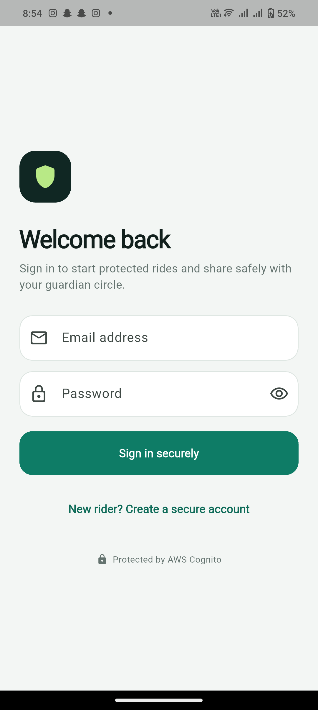
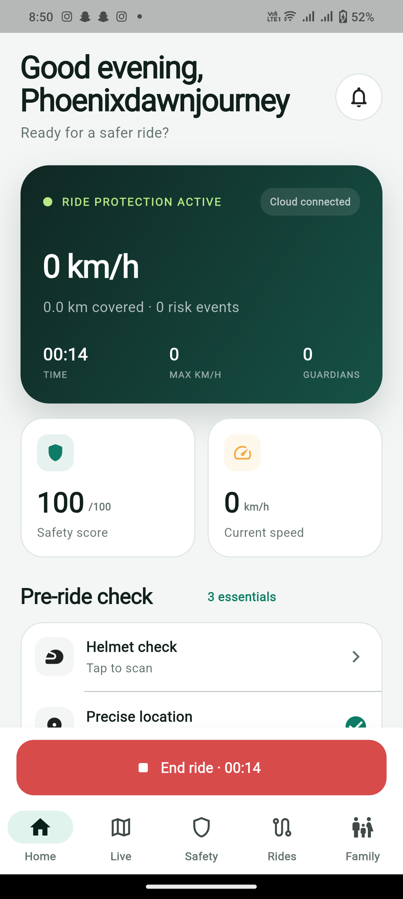
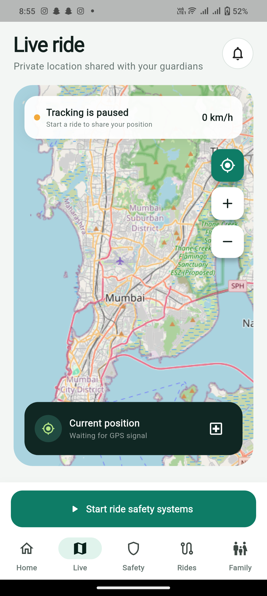
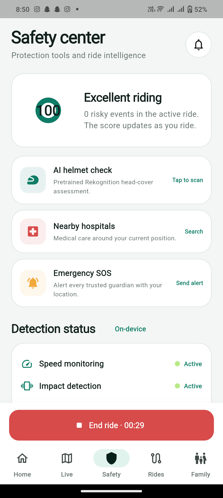
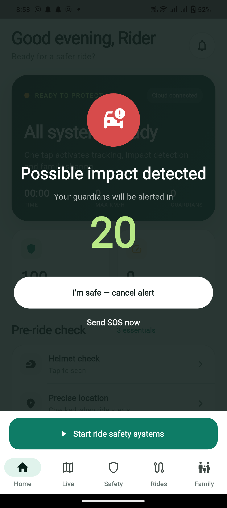
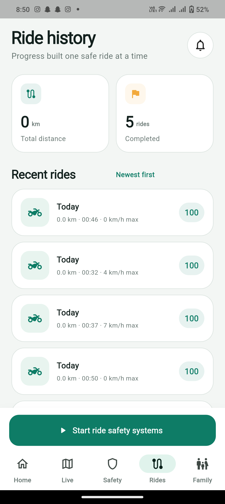
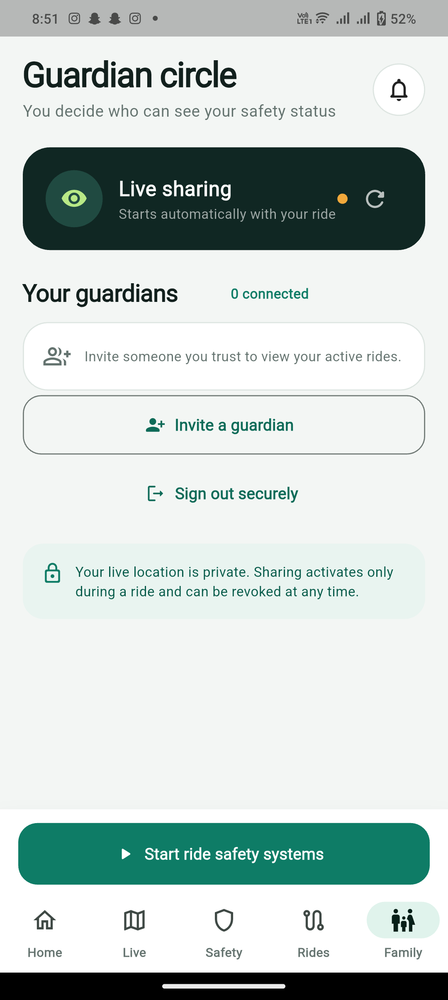
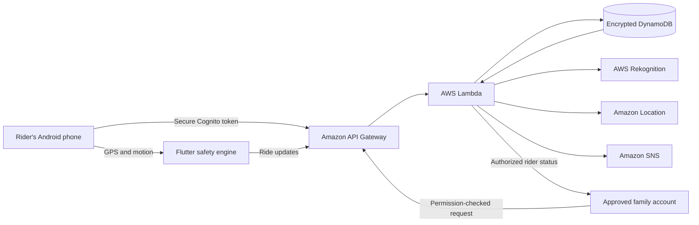

# RideGuardian AI

> A smart motorcycle safety companion that watches the ride, detects possible
> danger, helps the rider find medical care, and keeps approved family members
> informed.

RideGuardian AI is a Flutter Android application with a serverless AWS backend.
The experience is intentionally simple: the rider signs in and presses one
large button to start or stop every ride-safety system.

**Client-ready document:** [Download the illustrated PDF overview](output/pdf/RideGuardian_AI_Client_Overview.pdf)

## The product in one minute

| For the rider | For the family |
|---|---|
| One button starts GPS, speed, motion, impact, route, and cloud monitoring. | Only accepted guardians can see a rider's shared status. |
| A possible accident opens a 20-second cancellation window before SOS. | Guardians can check whether the rider is riding, safe, or offline. |
| The app checks helmets, finds hospitals, calculates routes, and scores rides. | The Family view shows safety score, speed, last update, location, and alerts. |

> **About these images:** The application screens below were captured from the
> working Android app running on a physical Vivo V2031 phone. The emergency
> countdown image is a safe presentation preview so no real SOS is dispatched.
> Live tracking is shown paused to avoid publishing the phone's precise GPS
> coordinates in this public repository.

## Product walkthrough

### 1. Secure access

Every rider and guardian receives an individual account. AWS Cognito handles
email verification, sign-in, secure sessions, and token refresh.

<p align="center">
  
</p>

### 2. One control for the whole ride

The persistent **Start ride safety systems** button is available from every
screen. During a ride it becomes **End ride**, displays elapsed time, and turns
red so its purpose is immediately clear.

Starting a ride activates:

- precise GPS and live location;
- current speed, maximum speed, and distance;
- accelerometer and gyroscope monitoring;
- harsh braking, acceleration, turning, and impact rules;
- family location heartbeats;
- ride scoring and history collection.

Ending the ride stops those sensor subscriptions and network heartbeats, marks
the rider safe, and saves the ride summary.

<p align="center">
  
</p>

### 3. Live ride and medical routing

The Live screen communicates the most important information without distracting
the rider: tracking state, current speed, current GPS position, nearby
hospitals, and a route estimate to the selected hospital. The production screen
uses an interactive OpenStreetMap map: drag or pinch to explore, use +/− to
zoom, or tap the GPS control to resume automatic rider following. The green
line records the path travelled and red markers identify nearby hospitals.

<p align="center">
  
</p>

Amazon Location Service performs the real nearby-place search and scooter-route
calculation. The rider can hand the destination to Google Maps for navigation.

### 4. Safety center

The Safety screen brings the protection tools together:

- safety score and detected-risk count;
- pretrained AI helmet assessment;
- nearby hospital search;
- manual emergency SOS;
- status of speed, impact, behavior, and family-sharing systems.

<p align="center">
  
</p>

### 5. Possible-accident response

When the phone sensors detect a strong possible impact, RideGuardian covers the
screen with a high-visibility alert and starts a 20-second countdown. A safe
rider can cancel the alert, reducing false alarms. If it is not cancelled, the
backend records and publishes the emergency with the latest available location.
The rider can also send an SOS manually at any time.

<p align="center">
  
</p>

### 6. Understand every ride

Completed rides are stored in the rider's private cloud history. Each summary
shows when the ride happened, distance, duration, maximum speed, event count,
and safety score.

<p align="center">
  
</p>

### 7. Family guardian circle

The rider controls access. A family member cannot view ride data until the
rider invites their exact account email and the family member accepts.
Permission is checked again by the backend whenever live rider status is
requested.

<p align="center">
  
</p>

The Family view supports:

- sending and accepting guardian invitations;
- listing trusted guardians and shared riders;
- riding, safe, or offline state;
- last-update time, speed, and safety score;
- opening the rider's authorized last location;
- viewing in-app emergency alerts.

## What has been implemented

| Capability | What the user receives | Implementation |
|---|---|---|
| Account security | Email registration, verification, login, logout | AWS Cognito + Amplify |
| Universal ride control | One persistent Start/End button | Flutter controller and Android foreground service |
| Speed monitoring | Live and maximum speed in km/h | Android GPS through Geolocator |
| Location tracking | Interactive rider-following map, ride trail, coordinates, and cloud heartbeats | OpenStreetMap + Flutter Map + GPS + API Gateway + Lambda + DynamoDB |
| Ride distance | Distance accumulated along GPS route points | On-device route calculation |
| Rider behavior | Harsh acceleration, braking, and sharp-turn events | Accelerometer/gyroscope rules |
| Accident assistance | Impact alert, 20-second cancellation, automatic SOS | Motion analysis + Lambda + SNS |
| Manual SOS | Rider-triggered emergency with latest position | Authenticated emergency API |
| Helmet check | Camera photo assessment and confidence result | Pretrained AWS Rekognition PPE model |
| Nearby hospitals | Medical places near the current GPS fix | Amazon Location Places |
| Traffic route estimate | Scooter route distance and duration | Amazon Location Routes |
| Safety score | Clear 0–100 score affected by risk events | Deterministic, explainable scoring |
| Ride history | Private completed-ride summaries | DynamoDB |
| Family sharing | Invitation-based rider/guardian relationship | Cognito identity + DynamoDB permissions |
| Family status | Rider state, speed, score, time, and location | Permission-checked API |
| Resource control | Sensors and heartbeats stop after End ride | Central ride lifecycle controller |

## How the system works



### Why the backend does not need a separate “power” switch

The AWS backend is serverless. API Gateway and Lambda do not run as a permanent
server waiting on a virtual machine. They perform work only when the app sends a
request. Therefore, the app's universal button controls the parts that actually
consume continuous phone resources:

| Before ride | During ride | After ride |
|---|---|---|
| Sensors are idle | GPS and motion monitoring active | Sensor streams stopped |
| No live heartbeat | Location heartbeats sent | Heartbeats stopped |
| Status is safe/paused | Status is riding | Final safe status published |
| No ride timer | Timer and score active | Summary saved to history |

## AWS architecture

The deployed CloudFormation stack is **rideguardian-backend** in
**ap-south-1**.

| AWS service | Responsibility |
|---|---|
| Cognito User Pool | Accounts, verified email, secure tokens |
| API Gateway HTTP API | Public health route and JWT-protected app routes |
| Lambda (Python 3.13, ARM64) | Application logic and authorization checks |
| DynamoDB | Live state, ride history, invitations, relationships, alerts |
| Rekognition | Pretrained helmet/protective-equipment assessment |
| Amazon Location | Nearby hospitals and scooter routes |
| SNS | Encrypted emergency-alert topic |
| CloudFormation/SAM | Repeatable infrastructure deployment |

Backend safeguards include:

- JWT authentication on every private endpoint;
- permission checks for family access;
- no AWS keys or user passwords inside the APK;
- DynamoDB encryption at rest;
- DynamoDB point-in-time recovery;
- retained database protection during stack replacement/deletion;
- pay-per-request storage;
- encrypted SNS topic;
- least-scope Lambda service permissions.

## Pretrained AI—no model training required

RideGuardian calls the pretrained AWS Rekognition protective-equipment
capability for helmet assessment. No custom training pipeline or training
dataset is required for the MVP.

Speed, motion, and possible-impact detection are deterministic phone-sensor
rules. This makes their decisions understandable and keeps ride monitoring
responsive even when network quality is poor.

## Try the rider and guardian journey

### Install

1. Open this project in Android Studio.
2. Wait for Flutter and Gradle indexing to finish.
3. Start an Android emulator or connect a phone with USB debugging enabled.
4. Select the device and run `lib/main.dart`.
5. Alternatively, install
   `build/app/outputs/flutter-apk/app-debug.apk` directly on an Android device.

### Rider

1. Create an account using an accessible email address.
2. Enter the email verification code sent by Cognito.
3. Sign in and allow location, camera, motion, and notification permissions.
4. Press **Start ride safety systems**.
5. Open Live, Safety, or Family while the master control continues running.
6. Press **End ride** to stop monitoring and save the ride.

### Family member

1. Create and verify a second account for the family member.
2. In the rider account, open **Family** and invite that second account's exact
   email.
3. In the family account, open **Family**, refresh, and accept the invitation.
4. Select the shared rider to retrieve their authorized live status.

Nearby hospital search requires a current GPS fix. Helmet checking works best
with a clear, well-lit photo containing the rider's head and helmet.

## Current delivery status

- AWS stack: deployed and healthy
- CloudFormation status: `UPDATE_COMPLETE`
- Public API health check: HTTP 200
- Flutter analyzer: no issues
- Flutter tests: passing
- Client screenshot render test: passing at 430 × 932
- Android debug APK: built successfully

The debug APK is located at:

```text
build/app/outputs/flutter-apk/app-debug.apk
```

SHA-256:

```text
106E963A23C5118725CCC39C58D133027C01A43E9FE17C5E1CFEFDA20EF29755
```

## Important production notes

RideGuardian is a working safety MVP, not a certified crash-detection or
medical device. Before public release:

1. Calibrate impact and behavior thresholds through controlled, consented road
   testing across different phones and motorcycles.
2. Configure an SMS and/or Firebase Cloud Messaging delivery channel. The
   current build stores emergency alerts and shows them inside the authenticated
   Family view; SNS is provisioned but has no customer phone subscriptions.
3. Add clear consent, privacy, retention, and account-deletion workflows.
4. Complete background-location policy review for Google Play.
5. Add device-level integration tests, accessibility testing, and release
   signing.
6. Add production observability, alarms, abuse controls, and API throttling.

## Developer setup

Prerequisites:

- Flutter SDK
- Android Studio and Android SDK
- AWS CLI with the `rideguardian-admin` Identity Center profile
- AWS SAM CLI

```powershell
C:\src\flutter\bin\flutter.bat pub get
C:\src\flutter\bin\flutter.bat analyze
C:\src\flutter\bin\flutter.bat test
C:\src\flutter\bin\flutter.bat run
```

Regenerate the client screenshots after a visual change:

```powershell
C:\src\flutter\bin\flutter.bat test tool\generate_readme_screenshots_test.dart --update-goldens
```

Deploy the backend:

```powershell
cd backend
sam build
sam deploy --profile rideguardian-admin --region ap-south-1
```

The deployed mobile configuration is in
`lib/config/aws_config.dart`. Another API can be supplied without changing
source code:

```powershell
C:\src\flutter\bin\flutter.bat run --dart-define=API_BASE_URL=https://YOUR_API/v1
```

## API routes

Only `GET /health` is public. Every other route requires a valid Cognito JWT.

| Method | Route | Purpose |
|---|---|---|
| GET | `/health` | Backend health |
| POST | `/location` | Publish rider status and position |
| GET/POST | `/rides` | Read or save ride history |
| POST | `/emergency` | Record and publish SOS |
| POST | `/helmet-check` | Analyze a JPEG helmet photo |
| GET | `/nearby-hospitals` | Search nearby medical places |
| GET | `/route` | Calculate a scooter route |
| GET | `/guardians` | List accepted guardians |
| POST | `/guardians/invite` | Invite a guardian by email |
| GET | `/guardians/invitations` | List invitations for the signed-in user |
| POST | `/guardians/accept` | Accept a guardian invitation |
| GET | `/shared-riders` | List riders sharing with this guardian |
| GET | `/rider-status` | Read a permitted rider's latest state |
| GET | `/alerts` | Read permitted rider emergency alerts |

## Project map

```text
lib/
├── config/          Deployed AWS identifiers
├── controllers/     Authentication and ride lifecycle state
├── models/          Ride, guardian, route, and alert models
├── screens/         Sign-in and five-tab application UI
├── services/        Cognito, backend API, GPS, and sensor integration
└── theme/           Material 3 design system

backend/
├── src/app.py       Lambda application
└── template.yaml    SAM/CloudFormation infrastructure

docs/images/         Real rendered client walkthrough frames
test/                Normal Flutter widget tests
tool/                Repeatable screenshot generator
```

---

**RideGuardian AI — one tap for a safer ride and better-informed family.**
